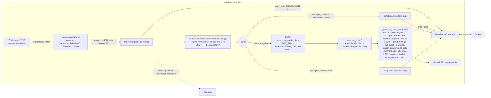

# AUDIT.md — Đánh giá hiện trạng bot XAUUSD (nhánh `hardening/go-live`)

Ngày đánh giá: 2026-11-25. Commit gốc: `ae54ca3` (main).

> ## ⚠️ CẢNH BÁO BẢO MẬT — CẦN LÀM NGAY
>
> 1. **Token Telegram bot đã bị lộ công khai.** Repo này là **public**. Token của bot `8957841283:AA…` nằm trong lịch sử git (file `.runtime/telegram-config.json`, các commit ngày 2026-11-09 → 2026-11-11, ví dụ `05c4a75`, `9d77ec1`, `f7f9387`) **và vẫn còn trong HEAD của main** dưới dạng "mã hóa" XOR với khóa nằm ngay cạnh (`_TG_CIPHER_BYTES` / `_TG_VAULT_KEY` trong `MO_WEB_TRUC_TIEP_KHONG_CAN_SERVER.html` và `apps/web/public/standalone-ui.html`). Giải mã chỉ mất 1 dòng code.
>    **Việc cần làm:** mở @BotFather → `/revoke` (hoặc `/token`) để thu hồi token cũ và tạo token mới → chỉ lưu token mới trong `.env` (biến `TELEGRAM_BOT_TOKEN`). Nhánh này đã xóa token khỏi HEAD, nhưng **lịch sử git vẫn còn** cho đến khi bạn quyết định viết lại lịch sử (xem DECISIONS.md D-009).
> 2. **Danh tính tài khoản MT5 LIVE bị lộ công khai.** Lịch sử git chứa `.runtime/active-mt5-account.json` (số login LIVE, server `DBG Market Limited`, mã `XAUUSD.G`, `liveArmed: true`, `fixedLot`), `.runtime/mobile-internet-url.txt` (URL tunnel công khai tới bảng điều khiển) và chat ID Telegram. Số login vẫn được hard-code trong HEAD (giao diện HTML, `scripts/xauusd-standalone-server.mjs`, test). **Không** tìm thấy mật khẩu MT5 (trường `password` rỗng).
>    **Việc cần làm:** đổi mật khẩu master + investor của tài khoản MT5, bật 2FA cho tài khoản khu vực khách hàng (client portal) của broker, đảm bảo URL tunnel cũ đã chết, cân nhắc mở tài khoản LIVE mới cho bot.
> 3. Khóa API khác (MT5 bridge `MT5_API_KEY`, `ZIQ_V6_CONTROL_TOKEN`): không thấy giá trị thật trong code/lịch sử; chỉ có khóa giả trong test (đã rà soát, xem S-4).

Công cụ đã dùng: `gitleaks 8.21.2` (toàn bộ 617 commit trên mọi nhánh + thư mục làm việc), tìm thủ công theo mẫu token Telegram, `pip-audit 2.10`, `pnpm audit`, đọc mã nguồn.

---

## 1. Kiến trúc và luồng dữ liệu → tín hiệu → lệnh

Repo có **hai runtime song song**:

| Runtime | Thành phần | Đặt lệnh qua | Được dùng bởi |
|---|---|---|---|
| **V6 (đang chạy thật)** | `CHAY_NHANH_1_CHAM.bat` → `scripts/xauusd-standalone-server.mjs` (web :5717, API :3711) → spawn `scripts/mt5-direct-probe.py` mỗi chu kỳ → thư viện Python `MetaTrader5` | `mt5.order_send` trực tiếp trong `mt5-direct-probe.py` (4 điểm gọi) | Launcher 1 chạm, các commit gần nhất (#140–#150) |
| Phase7C (monorepo) | `apps/web` (React) + `apps/api` (Express) + `packages/*` (risk/strategy/execution engine TS) + bridge FastAPI `packages/mt5-broker/bridge` | `POST /v1/orders` của bridge | Script PowerShell phase7c |

Nhánh này tập trung làm cứng **runtime V6** vì đó là đường đi đặt lệnh thực tế (D-001). Bridge Phase7C mặc định `MT5_TRADING_ENABLED=false` (trả HTTP 423).

Điểm mạnh sẵn có (giữ nguyên): fail-closed ở hầu hết các bước, SL bắt buộc và kiểm tra đúng phía, khóa liên tiến trình cho lệnh mới, marker "uncertain entry" chống gửi trùng khi mất phản hồi, đối soát reject/partial fill, giới hạn lỗ ngày tính từ lịch sử deal MT5 và lưu bền qua restart, kiểm tra margin hai lần, kiểm tra độ mới của giá theo offset UTC của broker.

---

## 2. Danh sách phát hiện

Trạng thái: **Đã sửa** (trong nhánh này) · **Giảm thiểu** (rủi ro còn nhưng đã chặn bằng lớp khác) · **Người dùng xử lý** · **Còn mở**.

### Nghiêm trọng

| ID | Vấn đề | Trạng thái |
|---|---|---|
| S-1 | Token Telegram bot lộ trong lịch sử git **và** trong HEAD (XOR với khóa đặt cạnh, 2 file HTML). Chat ID mặc định cũng hard-code. | **Đã sửa trong HEAD** (xóa cipher, xóa chat ID mặc định, không còn fallback token). **Người dùng xử lý**: thu hồi token qua BotFather; quyết định viết lại lịch sử (D-009). |
| S-2 | Lịch sử git lộ số login LIVE, server, cấu hình lot, trạng thái ARM, URL tunnel công khai, chat ID. | **Người dùng xử lý** (đổi mật khẩu MT5, 2FA portal broker, quyết định viết lại lịch sử). Số login đã bỏ khỏi giá trị mặc định trong `mt5-direct-probe.py`; vẫn còn trong HTML/server/test (S-7). |

### Cao

| ID | Vấn đề | Trạng thái |
|---|---|---|
| R-1 | Trần rủi ro 1%/lệnh và 1.5%/danh mục chỉ là **cảnh báo** (FIXED_LOT vẫn gửi lệnh vượt trần). Không có tính khối lượng theo % rủi ro. | **Đã sửa**: trần cứng; mặc định `RISK_PERCENT` tự **giảm** lot về mức 1% theo khoảng cách SL (không bao giờ tăng); `FIXED_LOT` bị chặn nếu vượt trần (D-003). Test: `test_v6_go_live_guard.py`, T16. |
| R-2 | Không có chế độ DRY_RUN; không có xác nhận kép để bật live ở tầng runtime. | **Đã sửa**: `XAUUSD_DRY_RUN` mặc định `true` chặn mọi lệnh gửi broker; tài khoản REAL cần thêm `XAUUSD_LIVE=true` **và** `XAUUSD_CONFIRM_LIVE=yes` (cộng dồn với ARM sẵn có) (D-002). |
| R-3 | Không có giới hạn lỗ tuần, số lệnh mở tối đa, tổng khối lượng tối đa. Giới hạn lỗ ngày có thể bị client nâng lên 5%. | **Đã sửa**: lỗ tuần 6% (từ lịch sử deal, fail-closed), tối đa 3 lệnh, 0.20 lot; lỗ ngày bị kẹp ≤ 3% bất kể cấu hình từ web (D-007). |
| R-4 | Không có bộ lọc tin mạnh (NFP/CPI/FOMC) và phiên thanh khoản thấp. | **Đã sửa**: lịch tin JSON do người vận hành duy trì (thiếu/hết hạn → chặn), cửa sổ rollover 20:45–23:15 UTC, cuối tuần, đóng cửa thứ Sáu, mở cửa thứ Hai (D-005, D-006). |
| R-5 | Kill switch: có latch emergency-stop nhưng không có lệnh dừng đơn giản bằng dòng lệnh / file cờ / Telegram, không có tùy chọn đóng toàn bộ vị thế. | **Đã sửa**: `scripts/v6_kill_switch.py` (on/off/status, `--flatten --confirm-flatten`), file cờ `.runtime/KILL_SWITCH`, biến `XAUUSD_KILL_SWITCH=1`, `scripts/v6_telegram_kill_listener.py` (`/kill`, `/kill_flatten <PIN>`, `/resume <PIN>`, `/status`) (D-004). |
| D-1 | Lỗ hổng dependency production: `proxy-addr` (critical), `body-parser`, `qs` (qua express của `apps/api`), `axios`, `follow-redirects` (`apps/web`). | **Đã sửa**: override phiên bản vá trong `pnpm-workspace.yaml`, nâng `axios` ^1.21.1, `vite` ^8.2.4. `pnpm audit --prod` = 0 lỗ hổng. Build web/api và test TS vẫn xanh. |
| O-1 | Không có log có cấu trúc riêng cho quyết định rủi ro, không có heartbeat/health check, không cảnh báo khi chạm giới hạn lỗ / mất kết nối. | **Đã sửa**: `.runtime/logs/v6-guard.jsonl` (đã che secret và số tài khoản), `.runtime/v6-heartbeat.json` + `scripts/v6_healthcheck.py`, cảnh báo Telegram (khớp lệnh, lệnh không chắc chắn, chạm lỗ ngày/tuần, kill switch, mất kết nối MT5, heartbeat cũ). |
| O-2 | Không có CI cho quét secret / audit dependency trên PR. | **Đã sửa**: `.github/workflows/go-live-hardening-ci.yml` (ruff, 491 test Python, test bridge, test Node, gitleaks cây làm việc + commit mới của PR, pip-audit, pnpm audit). |

### Trung bình

| ID | Vấn đề | Trạng thái |
|---|---|---|
| B-1 | Lệnh mới từng bị chặn vĩnh viễn trên main: `_check_runtime_emergency_stop_latch()` luôn trả về `STOP_RELEASE_HOST_AUTH_UNVERIFIED`, nên bot chỉ quản lý vị thế. | **Đã sửa theo quyết định của chủ repo** (D-011): thiếu latch hoặc latch `AUTHORIZED_CLEAR` đúng tài khoản thì cho phép; Emergency Stop, stop-intent, latch hỏng/sai tài khoản vẫn chặn. Gỡ Emergency Stop bằng `scripts/v6_emergency_stop_release.py`. |
| A-1 | Hai runtime đặt lệnh song song (V6 và Phase7C bridge) tăng nguy cơ chạy nhầm / chạy đồng thời. | **Giảm thiểu**: bridge Phase7C mặc định tắt giao dịch; RUNBOOK chỉ hướng dẫn V6. Khuyến nghị lưu trữ (archive) một trong hai. |
| S-3 | `ZIQ_TG_MASTER_SECRET` có giá trị mặc định hard-code trong `xauusd-standalone-server.mjs` và salt chứa số login → "mã hóa AES" token Telegram trên đĩa chỉ là che giấu nếu không đặt biến môi trường. Giao diện HTML lưu token trong `localStorage` trình duyệt (XOR). | **Giảm thiểu**: SECURITY.md yêu cầu đặt `ZIQ_TG_MASTER_SECRET`; alert mới chỉ đọc token từ `.env`. Không đổi salt để không làm hỏng token đã lưu (D-017). Healthcheck nay cảnh báo `TELEGRAM_VAULT_KEY_DEFAULT` khi `ZIQ_TG_MASTER_SECRET` chưa đặt hoặc dùng giá trị mặc định công khai. |
| S-7 | Hồ sơ mặc định của server V6 là tài khoản LIVE của chủ repo (login/server hard-code). | **Giảm thiểu** bằng DRY_RUN + LIVE/CONFIRM_LIVE + ARM. Không đổi vì 3 test hồi quy mã hóa hành vi này (D-010). |
| D-2 | Lỗ hổng chỉ ở dev-dependency: `vitest` 2.x / `vite` 6 / `tinypool` (critical), `esbuild`. Không được đóng gói vào runtime. | **Còn mở** (nâng vitest 2→4 là thay đổi major trên ~20 package). |
| T-1 | Không có dữ liệu lịch sử thật trong repo; báo cáo `.xlsx` sẵn có gộp Thắng + BE thành "win rate" 77% và không ghi nguồn/khoảng thời gian. | **Giảm thiểu**: thêm runner backtest offline dùng đúng engine live + script xuất dữ liệu MT5 chỉ-đọc. Kết quả hiện tại chỉ trên dữ liệu tổng hợp (BACKTEST_REPORT.md). |
| E-1 | `deviation` (50 point = 0.50 USD) và `magic` hard-code trong V6; trượt giá chỉ bị chặn bởi deviation của broker. | **Đã sửa** (D-019): `XAUUSD_ENTRY_DEVIATION_POINTS` (mặc định 50, tối đa 100) và `XAUUSD_CLOSE_DEVIATION_POINTS` (mặc định 50, tối đa 300). `magic` 270715 giữ cố định vì đối soát vị thế dựa vào nó. Trượt giá thực tế được đo và cảnh báo (D-020). |
| E-2 | Kill-switch flatten chỉ đóng vị thế, không hủy lệnh chờ (V6 chỉ dùng lệnh market). | **Giảm thiểu**: flatten nay báo số lệnh chờ vàng còn lại và ticket, trạng thái `KILL_SWITCH_FLATTEN_INCOMPLETE` nếu còn lệnh chờ hoặc không đọc được sổ lệnh; RUNBOOK hướng dẫn xóa tay. Không thêm lệnh hủy tự động (giữ nguyên 4 điểm `order_send` đã kiểm toán). |
| Q-1 | Độ phức tạp vận hành rất cao: 158 workflow, 322 script PowerShell, hàng chục tài liệu phase. | Còn mở (khuyến nghị dọn dẹp sau go-live). |

### Thấp

| ID | Vấn đề | Trạng thái |
|---|---|---|
| S-4 | gitleaks báo 11 "generic-api-key" trong test/fixture/docs: đều là khóa giả (`0123456789abcdef`), đọc biến môi trường hoặc chuỗi tài liệu. | Đã rà soát; allowlist theo đường dẫn trong `.gitleaks.toml`. |
| Q-2 | Lint không áp dụng cho mã cũ. | CI lint cho các module mới; mở rộng dần. |
| C-1 | Đồng hồ lệch: kiểm tra độ mới cho phép tick "trong tương lai" tới 10s. | **Đã sửa thêm**: guard chặn khi tick đi trước đồng hồ máy > 5s (`XAUUSD_MAX_CLOCK_SKEW_SEC`). |

---

## 3. Độ tin cậy (giai đoạn 4) — đối chiếu

| Yêu cầu | Hiện trạng sau nhánh này |
|---|---|
| Tự kết nối lại + backoff | Server spawn probe mỗi chu kỳ (mỗi lần kết nối lại). Thêm retry `initialize/login` 3 lần, backoff 1s→2s (không bao giờ retry `order_send`). Bridge Phase7C có reconnect + backoff 2s sẵn. Telegram listener backoff tới 60s. |
| Chống đặt trùng | Khóa liên tiến trình + marker in-flight bền vững theo `login|server`; mất phản hồi ⇒ đóng băng, không gửi lại (có sẵn, đã có test). |
| Đồng bộ trạng thái khi khởi động lại | Probe không giữ trạng thái: mỗi chu kỳ đọc lại vị thế/lệnh chờ/deal từ broker; trạng thái quản lý vị thế lưu theo ticket; lỗ ngày lưu bền. |
| Lệnh bị từ chối / khớp một phần | `_broker_rejection_ack_reconciliation`, `_reconcile_filled_order` (có sẵn, có test). |
| Lệch giờ | Offset UTC broker bắt buộc (`V6_BROKER_UTC_OFFSET_HOURS`), freshness, + chặn lệch giờ mới. |
| Log có cấu trúc + cảnh báo + heartbeat | Đã thêm (O-1). |

## 4. Kết luận

Không còn phát hiện mức **Nghiêm trọng/Cao** nào ở trạng thái "Còn mở" trong mã nguồn. Hai mục Nghiêm trọng S-1/S-2 đã được xử lý trong HEAD nhưng **đòi hỏi bạn hành động** (thu hồi token, đổi mật khẩu) vì đó là các bước không thể làm thay. Chủ repo đã chọn không viết lại lịch sử git (D-009), nên hai bước đó là bắt buộc. Mục B-1 đã được mở khóa theo quyết định của chủ repo (D-011): bot được vào lệnh mới trên demo hoặc live, vẫn sau cổng 2 cờ và mọi giới hạn rủi ro.
